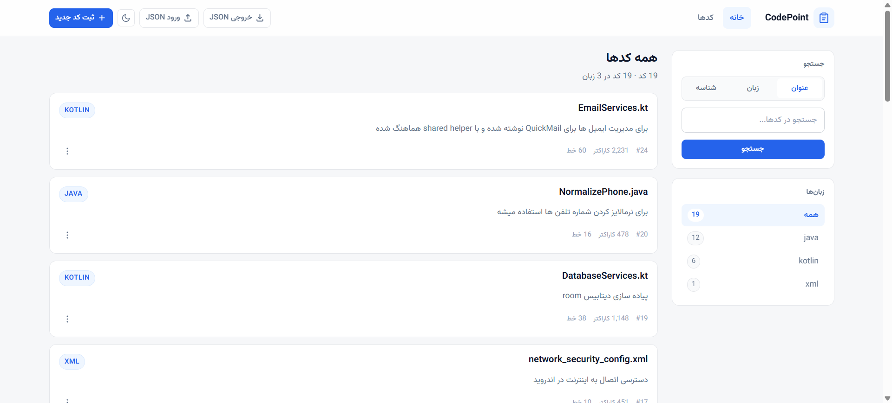
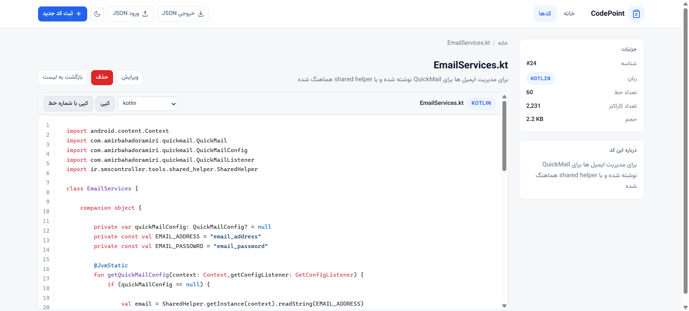
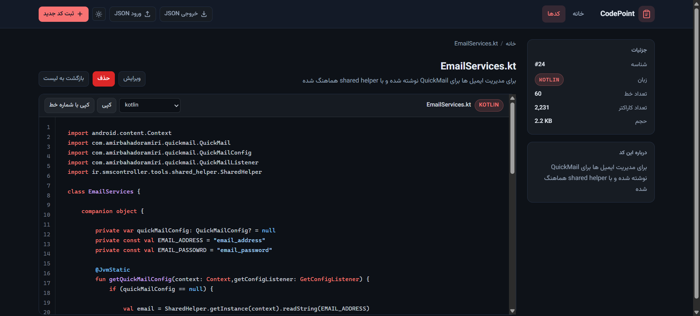

# CodePoint

> 🌍 [English version](./README.md)

مدیریت قطعه‌کد با رابط راست‌به‌چپ.



<div align="center">

| روشن | تیره |
| --- | --- |
|  |  |

</div>

`PHP 8.2` · `MySQL / MariaDB` · `Apache` · `highlight.js` · `Vazirmatn`

## امکانات

- جستجو بر اساس عنوان، زبان یا شناسه، و فیلتر زبان با تعداد هر زبان.
- نمایشگر با شماره خط، هایلایت سینتکس، و کپی با یا بدون شماره خط.
- منوی راست‌کلیک روی هر کد: کپی، ویرایش، حذف.
- پوستهٔ روشن و تیره.
- خروجی و ورودی JSON. ورود بر اساس `code_id` ادغام می‌کند و چیزی را پاک نمی‌کند.
- حذف با POST انجام می‌شود؛ کوئری‌ها escape می‌شوند و ورود JSON با prepared statement است.

## نصب

نیازمند PHP 8.0+ با `mysqli`، MySQL 5.7+ یا MariaDB 10.4+، و آپاچی.

**۱.** پوشهٔ `CodePoint/` را داخل وب‌روت کپی کن.

**۲.** اسکیما را ایمپورت کن:

```bash
mysql -u root -p < database.sql
```

یا از بخش Import در phpMyAdmin استفاده کن.

**۳.** اطلاعات اتصال را بالای `tools/SQLHelper.php` بگذار (پیش‌فرض: `localhost`، `root`، پسورد خالی، `code_point`).

**۴.** Apache و MySQL را روشن کن و `http://localhost/CodePoint/` را باز کن.

> ⚠️ فایل `database.sql` جدول `codes` را پاک می‌کند، پس ایمپورت آن روی یک نصب موجود کدهای شما را از بین می‌برد.

فونت و highlight.js از CDN بارگذاری می‌شوند؛ بقیهٔ برنامه آفلاین کار می‌کند.

## ساختار

```text
index.php        # لیست، جستجو، فیلتر زبان، منوی راست‌کلیک
read.php         # نمایشگر: شماره خط، هایلایت، کپی
api.php          # POST: درج / ویرایش / حذف / ورود
backup.php       # خروجی JSON
database.sql     # اسکیما
images/          # فاوآیکون
screenshot/      # تصویر بالا
tools/
  SQLHelper.php  # اتصال و متدهای کوئری  ← اطلاعات اتصال اینجاست
  header.php     # <head>، نوار بالا، مودال‌ها و توست‌های مشترک
  import.php     # ورود JSON، ادغام بر اساس code_id
  style.css      # استایل
```

## پروانه

[GPL-3.0](./LICENSE)