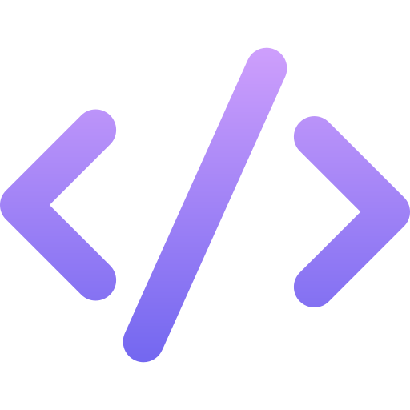
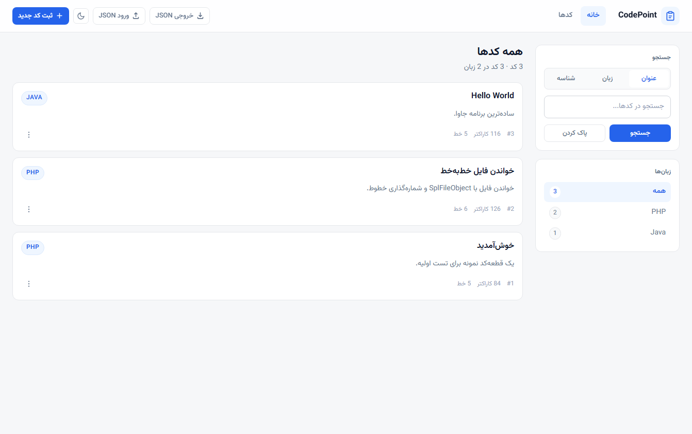
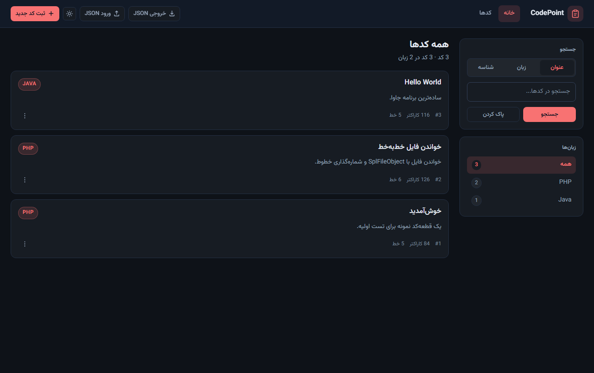
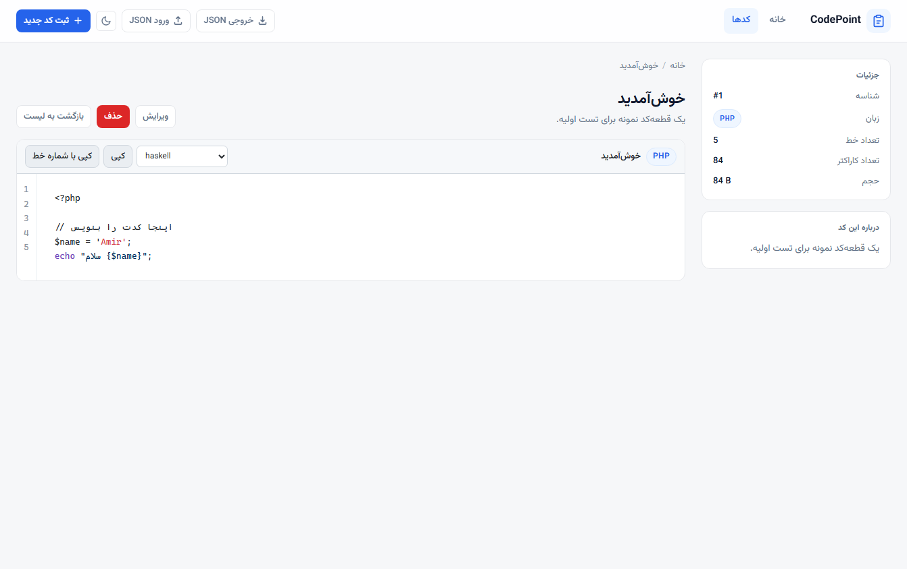
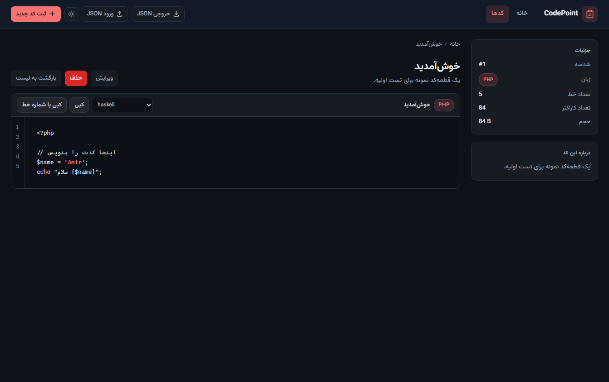

<p align="center">
  🌍 Read in English: <a href="README.md"><b>English</b></a>
</p>

<p align="center">
  
</p>

# کدپوینت (CodePoint) 🧩
### مدیریت قطعه‌کد، کاملاً آفلاین، داخل خود مرورگر.

**کدپوینت** یک اکستنشن کروم برای مدیریت قطعه‌کدهای شخصی است — جستجو، فیلتر، نمایش با هایلایت سینتکس، و همه‌چیز داخل مرورگر خودت. این نسخه، جانشینِ کاملاً مستقل اپ تحت وب کدپوینت است: بدون سرور، بدون دیتابیس، بدون هیچ درخواست شبکه‌ای.

---

## 🆕 تغییرات نسخهٔ ۱.۰.۰ — از سایتِ روی هاست، به اکستنشنِ مستقل

این نسخه، کدپوینت را از یک اپ PHP + MySQL به یک اکستنشن مرورگر تبدیل کرده است:

*   **بدون سرور، بدون راه‌اندازی:** تمام بک‌اند PHP + MySQL با `chrome.storage.local` جایگزین شده — اکستنشن را لود کنید و تمام.
*   **واقعاً آفلاین:** highlight.js، فایل‌های گرامر و فونت وزیرمتن داخل خود پکیج قرار دارند — هیچ چیزی از CDN بارگذاری نمی‌شود.
*   **امکانات مخصوص اکستنشن:** روی هر کد انتخاب‌شده در وب راست‌کلیک کنید تا در فرم ثبت ذخیره شود؛ و اپ را با میان‌بر `Alt+Shift+K` باز کنید.

---

## 🌟 ویژگی‌های کلیدی

### 📝 مدیریت قطعه‌کدها
*   افزودن، ویرایش و حذف کدها با همان دیالوگ نسخهٔ وب و تأییدیهٔ حذف.
*   **جستجوی لحظه‌ای بر اساس عنوان، زبان یا شناسه،** به‌همراه فیلتر زبان با شمارندهٔ هر زبان که در URL هم حفظ می‌شود.
*   هر تغییری، همهٔ تب‌های باز را همان لحظه به‌روز می‌کند — بدون رفرش.

### 👁 نمایشگر کد
*   **هایلایت سینتکس کاملاً آفلاین:** highlight.js حدود ۹۰ زبان را از فایل‌های داخل خود اکستنشن پوشش می‌دهد؛ گرامرها به‌صورت تنبل از داخل پکیج لود می‌شوند.
*   شماره‌گذاری خطوط، آمار حجم / خط / کاراکتر هر کد، و امکان تغییر زبان و هایلایت دوباره در لحظه.
*   کپی با یا بدون شماره خط.

### 🔒 داده‌های شما، داخل مرورگر شما
*   همه‌چیز در `chrome.storage.local` ذخیره می‌شود — هیچ کدی مرورگر را ترک نمی‌کند.
*   **بکاپ JSON سازگار با سایت قبلی:** خروجی بگیرید یا فایل `codepoint-backup` را وارد کنید — ردیف‌ها بر اساس `code_id` ادغام می‌شوند و چیزی هرگز پاک نمی‌شود.
*   پوستهٔ روشن و تیره که سیستم را دنبال می‌کنند و با یک کلیک جابه‌جا می‌شوند.

---

## 🛠 تکنولوژی‌های استفاده شده

در توسعهٔ کدپوینت از ابزارها و کتابخانه‌های ساده و بی‌فریم‌ورک استفاده شده است:

*   **زبان:** JavaScript خالص و CSS — بدون فریم‌ورک و بدون مرحلهٔ build
*   **پلتفرم:** اکستنشن کروم با Manifest V3 (سرویس‌ورکر؛ کروم ۱۲۳ به بالا برای CSS `light-dark()`)
*   **ذخیره‌سازی:** `chrome.storage.local` با `unlimitedStorage` (جانشین MySQL؛ کدها داخل مرورگر می‌مانند)
*   **هایلایت سینتکس:** highlight.js 11.11.2 + ۵۳ گرامر اضافه، همگی به‌صورت محلی
*   **رابط کاربری:** فارسی و راست‌به‌چپ، فونت وزیرمتن (محلی)، تم‌های GitHub Light/Dark برای هایلایت

---

## 🚀 راهنمای نصب و اجرا

۱. ابتدا پروژه را از گیت‌هاب کلون کنید:
```bash
git clone https://github.com/AmirBahadorAmiri/CodePoint.git
```
۲. در کروم به `chrome://extensions` بروید.
۳. **Developer mode** را (بالا-راست) روشن کنید.
۴. روی **Load unpacked** بزنید و پوشهٔ `extension/` را انتخاب کنید.
۵. روی آیکون CodePoint در نوار ابزار کلیک کنید — اپ در یک تب کامل باز می‌شود.

---

## 📸 اسکرین‌شات‌ها

تصاویر مستقیماً از خود اکستنشن در هر دو پوسته گرفته شده‌اند؛ رابط کاربری راست‌به‌چپ است.

| 📋 فهرست کدها | 🌙 پوستهٔ تیره | 👁 نمایشگر | 🌙 نمایشگر (تیره) |
|:---:|:---:|:---:|:---:|
|  |  |  |  |

---

## 👨‍💻 توسعه‌دهنده
توسعه داده شده توسط **امیربهادر امیری**

> [!TIP]
> از سایت قبلی کدپوینت مهاجرت می‌کنید؟ خروجی JSON بگیرید و در اکستنشن دکمهٔ **ورود JSON** را بزنید — ردیف‌ها بر اساس `code_id` ادغام می‌شوند؛ نه چیزی تکرار می‌شود و نه چیزی از بین می‌رود.
