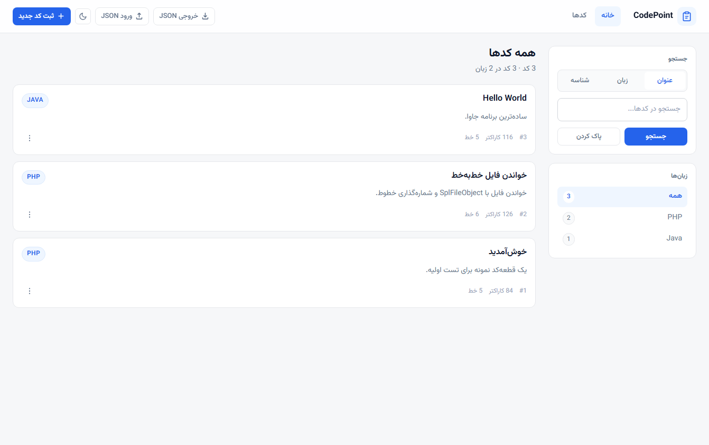
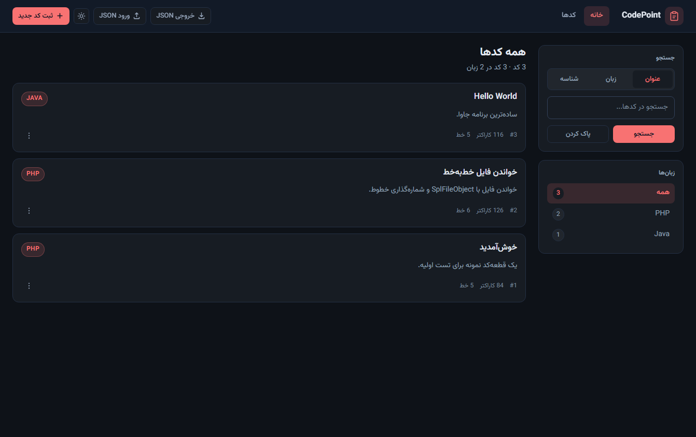
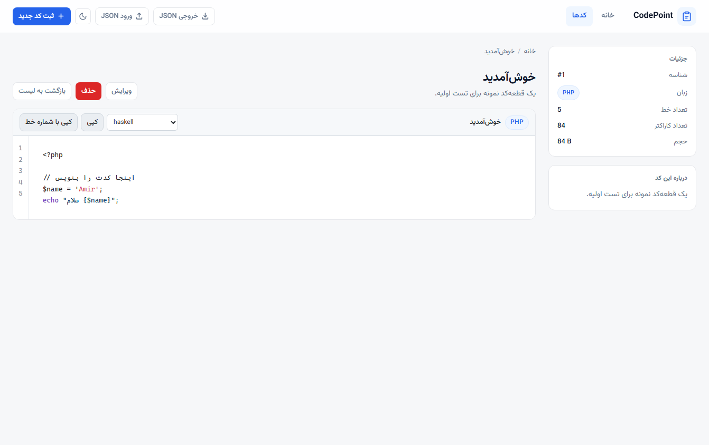
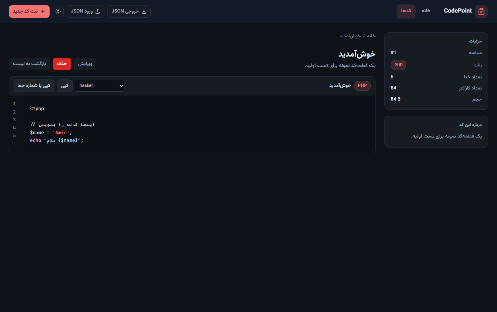

<p align="center">
  📄 Read in Persian: <a href="README.fa.md"><b>فارسی</b></a>
</p>

<p align="center">
  
</p>

# CodePoint (کدپوینت) 🧩
### A fully offline code-snippet manager, right in your browser.

**CodePoint** is a Chrome extension for managing personal code snippets — search, filter, view with syntax highlighting, and keep everything inside your own browser. It is the fully standalone successor of the CodePoint web app: no server, no database, no network at all.

---

## 🆕 What's New in v1.0.0 — From a Self-Hosted Site to a Standalone Extension

This release turns CodePoint from a PHP + MySQL web app into a browser extension:

*   **No server, no setup:** the whole PHP + MySQL backend is replaced by `chrome.storage.local` — load the extension and you are done.
*   **Truly offline:** highlight.js, its grammar files and the Vazirmatn font ship inside the package — nothing ever loads from a CDN.
*   **Extension-native extras:** right-click any selected code on the web to save it into the editor, and open the app with the `Alt+Shift+K` shortcut.

---

## 🌟 Key Features

### 📝 Snippet Management
*   Add, edit and delete snippets through the same dialog as the site, with a delete confirmation.
*   **Instant search by title, language or id,** plus a language filter with per-language counts that survives in the URL.
*   Any change re-renders every open tab the moment it happens — no reloads.

### 👁 Code Viewer
*   **Syntax highlighting that works offline:** highlight.js covers ~90 languages from files inside the extension; grammars load lazily from the package itself.
*   Line-number gutter, per-snippet size / line / character stats, and a language picker to re-highlight on the fly.
*   Copy with or without line numbers.

### 🔒 Your Data, Your Browser
*   Everything is stored in `chrome.storage.local` — no snippet ever leaves the browser.
*   **JSON backup compatible with the old site:** export, or import a `codepoint-backup` file — rows merge by `code_id` and nothing is ever deleted.
*   Light and dark themes that follow the system, switchable with one click.

---

## 🛠 Technologies Used

CodePoint is developed with plain, framework-free tools and libraries:

*   **Language:** Vanilla JavaScript and CSS — no framework, no build step
*   **Platform:** Chrome Extension, Manifest V3 (service worker; requires Chrome 123+ for CSS `light-dark()`)
*   **Storage:** `chrome.storage.local` with `unlimitedStorage` (stands in for MySQL; snippets live in the browser)
*   **Syntax highlighting:** highlight.js 11.11.2 + 53 extra grammars, all vendored locally
*   **UI:** RTL-first Persian interface, Vazirmatn font (vendored), GitHub Light/Dark highlighting themes

---

## 🚀 Installation & Run Guide

1. First, clone the project from GitHub:
```bash
git clone https://github.com/AmirBahadorAmiri/CodePoint.git
```
2. Open `chrome://extensions` in Chrome.
3. Turn on **Developer mode** (top-right).
4. Click **Load unpacked** and select the `extension/` folder.
5. Click the CodePoint icon in the toolbar — the app opens in a full tab.

---

## 📸 Screenshots

Captured from the extension itself in both themes; the interface is right-to-left.

| 📋 Snippet List | 🌙 Dark Theme | 👁 Viewer | 🌙 Viewer (Dark) |
|:---:|:---:|:---:|:---:|
|  |  |  |  |

---

## 👨‍💻 Developer
Developed by **Amir Bahador Amiri**

> [!TIP]
> Coming from the CodePoint website? Export its JSON backup and hit **Import JSON** in the extension — rows merge by `code_id`, so nothing duplicates and nothing is lost.
